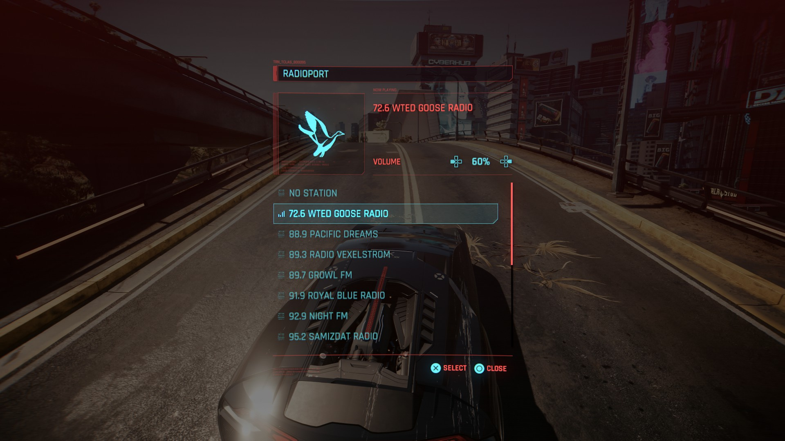

# WTED Radio for Cyberpunk 2077

Water your palms while cruising Night City!



I threw this together about a year and a half ago and forgot about it pretty much. Got back into Cyberpunk recently and wanted to get this out there.

This repo contains everything needed to get up and running with the mod. Including:
- [radioExt 2.81](https://github.com/justarandomguyintheinternet/CP77_radioExt)
- [CET 1.37.1](https://github.com/maximegmd/CyberEngineTweaks)
- [RED4ext 1.30](https://github.com/wopss/RED4ext)

These are the latest versions of these pre-reqs, and I've just put them all together here to make things easy for people. Depending on when you download this, those pre-reqs might be out of date and you'll have to update.

I can verify that this mod works on Windows 11 with the latest (2.31) version of Cyberpunk 2077. It *should* work on Mac/Linux, as well as other versions of the game, but I cannot confirm that.

# Instructions
1. Download the source code of this repo above
2. Extract the zip over your game install directory (Steam/steamapps/common/Cyberpunk 2077).
3. In the `bin\x64\plugins\cyber_engine_tweaks\mods\radioExt\radios\72.6 WTED Goose Radio` folder, there is a `metadata.json` file which you will have to edit. Open with whatever text editor you fancy and change the `Image Path` and `Archive Path` paths to match your game install directory. Make sure to change any slashes to backwards double slashes.

```
"Image Path": "[CYBERPUNK PATH HERE\\bin\\x64\\plugins\\cyber_engine_tweaks\\mods\\radioExt\\radios\\72.6 WTED Goose Radio\\white.png",
"Archive Path": "[CYBERPUNK PATH HERE\\bin\\x64\\plugins\\cyber_engine_tweaks\\mods\\radioExt\\radios\\72.6 WTED Goose Radio\\white.archive"
```

# Caveats I guess
- Due to how `radioExt` works, the currently playing song title will NOT be shown in-game. As far as I know that isn't currently possible with the mod. Maybe someone reading this who knows Lua can figure that out.